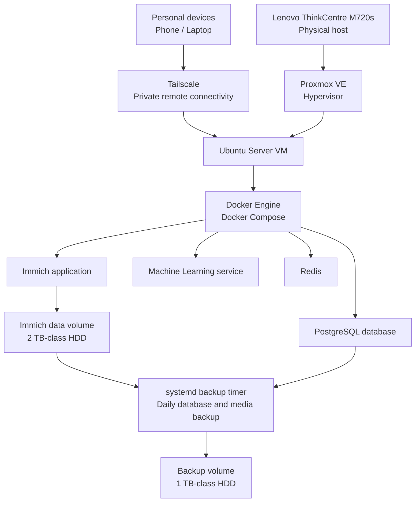

# Infrastructure Architecture

## 1. Project overview

This homelab provides a self-hosted platform for managing personal photos and videos. It is also a practical environment for learning virtualization, Linux administration, containerization, storage, networking, and backup operations.

## 2. Physical infrastructure

| Component | Current configuration |
|---|---|
| Hardware | Lenovo ThinkCentre M720s SFF |
| Processor | Intel Core i5, 9th generation |
| Memory | 16 GB RAM |
| System disk | 256 GB SSD |
| Additional storage | 1 TB HDD and 2 TB HDD |

The physical machine runs Proxmox VE as its hypervisor.

## 3. Logical architecture

The diagram shows the logical relationships. It does not imply that every path or feature has completed end-to-end validation.

## 4. Platform components

### Proxmox VE

Proxmox VE is installed on the physical ThinkCentre and provides the virtualization layer. The Ubuntu Server environment runs as a virtual machine.

### Ubuntu Server

Ubuntu Server hosts the application environment, Docker Engine, persistent storage mount points, and scheduled backup task.

### Docker and Immich

Immich is deployed using Docker Compose. Its stack includes the Immich application, machine-learning service, PostgreSQL database, and Redis.

### Storage and backups

Two separate hard drives are presented to the Ubuntu Server VM and mounted for different purposes:

- **Immich data volume:** stores the Immich library.
- **Backup volume:** stores PostgreSQL dumps and a synchronized copy of the Immich media library.

Both disks are installed in the same physical computer, so this is local backup storage rather than off-site disaster protection.

### Remote access

Tailscale is configured for private remote connectivity. Immich photo synchronization works when the VPN is disconnected. A separate connectivity issue occurs when the iPhone is connected through the VPN.

### Backup automation

A daily systemd timer runs the backup script. A selected original video has been restored from the media copy and verified using matching SHA-256 hashes. The October 31, 2026 PostgreSQL dump has also been restored into an isolated test container, where 72 tables and 8,636 asset records were readable.

## 5. Current validation status

| Area | Status |
|---|---|
| Proxmox VE host | Installed and accessible |
| Ubuntu Server VM | Installed and running |
| Docker Compose stack | Deployed; services reported healthy |
| Immich web application | Deployed |
| Separate data and backup volumes | Mounted |
| Immich photo synchronization | Working without VPN; issue occurs when VPN is connected |
| Scheduled database backup | Enabled |
| Media synchronization | Verified with rsync dry run |
| Selected media recovery | SHA-256 hashes matched |
| PostgreSQL restore | Restored and queried in isolated test container |
| Full Immich application recovery | Not yet tested |
| Off-site backup | Not yet implemented |

## 6. Known limitations and next improvements

- Both hard drives are inside the same physical host. Hardware failure, theft, or a major incident could affect both.
- A second disk in the same machine is not an off-site backup.
- The database and media have been tested separately, but full Immich application recovery has not been tested.
- Investigate why the iPhone cannot synchronize with Immich while connected through the VPN.

## 7. Security and documentation policy

This repository must not contain passwords, API tokens, private keys, Tailscale authentication keys, personal media, database dumps, or private configuration files.

Internal IP addresses, disk UUIDs, and other environment-specific identifiers are intentionally omitted from this overview.
